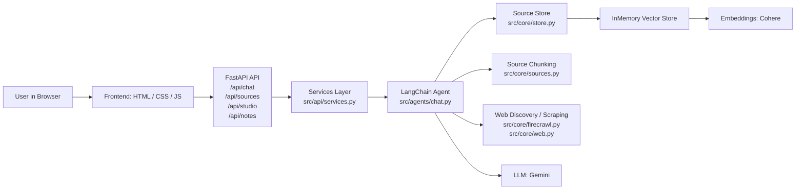
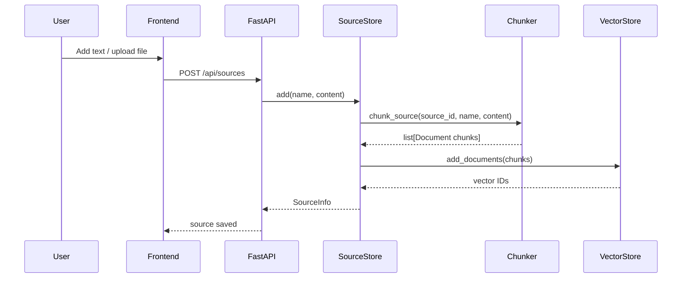
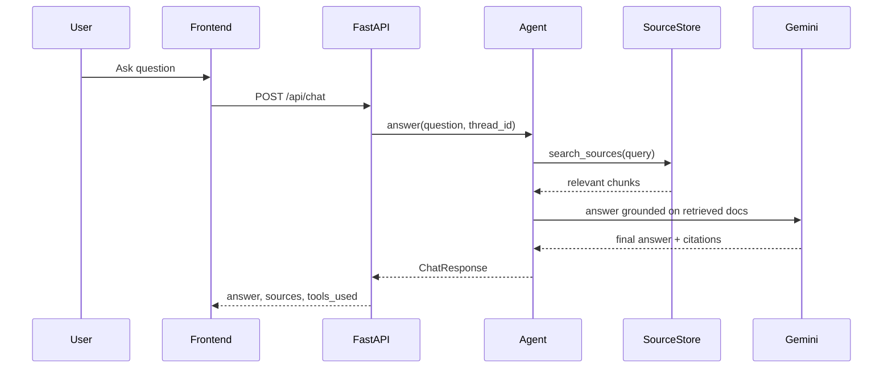
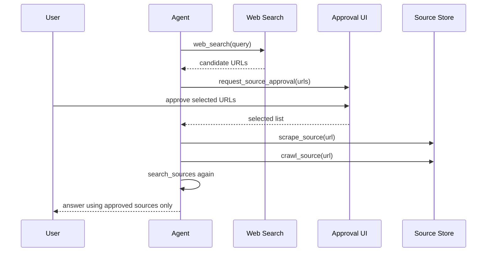
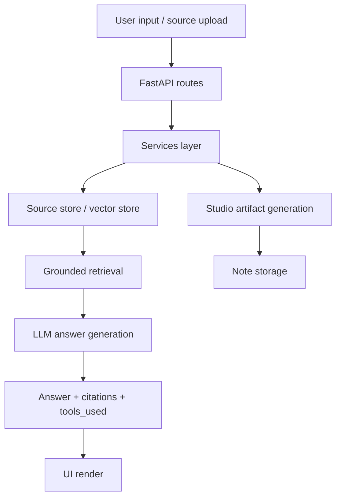

# Architecture Overview

This project is a NotebookLM-style research assistant built with Python, FastAPI, LangChain, and a lightweight browser frontend. The system lets users add sources, ask grounded questions, approve external sources, and generate artifacts like summaries, quizzes, and presentations.

---

## 1. High-Level Architecture

### Core concept
The app follows a grounded RAG pattern:

- sources are added by the user
- they are split into chunks
- chunks are embedded and stored in a vector database
- the agent searches relevant chunks before answering
- answers are grounded in approved notebook sources
- if data is missing, the agent can search and approve external web sources

---

## 2. System Layers

### Frontend layer
Location: `client/`

Responsibilities:
- renders the sources panel
- renders the chat panel
- handles source upload and toggling
- shows artifact generation actions
- displays notes and viewer modal

Main files:
- `client/index.html`
- `client/app.js`
- `client/styles.css`

### API layer
Location: `src/api/`

Responsibilities:
- expose HTTP endpoints
- validate requests
- translate HTTP input to service calls
- return structured JSON responses

Main files:
- `src/api/app.py` — FastAPI routes and static file hosting
- `src/api/services.py` — business logic for chat, sources, studio, notes
- `src/api/schemas.py` — Pydantic request/response models
- `src/api/serve.py` — server startup entry point

### Agent layer
Location: `src/agents/`

Responsibilities:
- orchestrate tools
- decide which tools to call
- manage grounded answer generation
- handle human-in-the-loop approval flows

Main file:
- `src/agents/chat.py`

The agent uses a set of tools such as:
- `search_sources`
- `web_search`
- `request_source_approval`
- `scrape_source`
- `crawl_source`
- `deep_web_research`

### Core / data layer
Location: `src/core/`

Responsibilities:
- source chunking
- embedding generation
- vector retrieval
- web search / scraping
- in-memory source registry

Main files:
- `src/core/sources.py`
- `src/core/store.py`
- `src/core/web.py`
- `src/core/firecrawl.py`

---

## 3. Runtime Flow

### A. Add source flow

### B. Chat / grounded answer flow

### C. Human-in-the-loop / web search flow

---

## 4. Source Storage and RAG Pipeline

The source lifecycle is centered around `SourceStore` in `src/core/store.py`.

### Storage model
Each source is represented as a dataclass:
- `id`
- `name`
- `content`
- `active`

The store keeps:
- `_sources`: all source records
- `_vector_store`: the in-memory vector DB
- `_vector_ids_by_source`: mapping from source to the document vector IDs

### Chunking
In `src/core/sources.py`:

- text is split with `RecursiveCharacterTextSplitter`
- chunk size is around 800 characters
- overlap is around 120 characters
- each chunk gets metadata:
  - `source`
  - `source_id`

This allows the agent to retrieve grounded chunks rather than whole documents.

### Retrieval
`SourceStore.search(query, k)` does the following:

1. takes only `active` sources
2. queries the vector store with semantic similarity
3. filters results by `source_id`
4. returns relevant documents for grounding

This is the key mechanism that makes the app "NotebookLM-like".

---

## 5. Agent Design

The agent in `src/agents/chat.py` is the orchestration layer.

It exposes tools of two kinds:

### Notebook tools
- `search_sources`
- `list_sources`
- `get_source`

These operate on internal data already saved by the user.

### Web / acquisition tools
- `web_search`
- `request_source_approval`
- `scrape_source`
- `crawl_source`
- `deep_web_research`

These are used when the answer cannot be drawn only from notebook sources.

### Human-in-the-loop middleware
The app protects web ingestion with `HumanInTheLoopMiddleware`.

This means:
- the agent can propose URLs
- the user approves or rejects them
- only approved sources are actually added to the notebook

This is a safety pattern that keeps the data grounded and user-controlled.

---

## 6. API Contract Overview

The server exposes a small but critical REST surface.

### Sources
- `GET /api/sources`
- `POST /api/sources`
- `POST /api/sources/upload`
- `GET /api/sources/{id}`
- `PATCH /api/sources/{id}`
- `DELETE /api/sources/{id}`

### Chat
- `POST /api/chat`
- `POST /api/chat/approve`

### Studio
- `GET /api/studio/artifacts`
- `POST /api/studio/generate`

### Notes
- `GET /api/notes`
- `POST /api/notes`
- `DELETE /api/notes/{id}`

---

## 7. Studio / Artifact Generation

The studio layer is implemented in `src/api/services.py`.

The app supports artifact generation based on active sources:
- Summary
- PowerPoint
- FAQ
- Quiz
- Infographic

The flow is:

1. aggregate active source contents
2. send them to the model prompt
3. parse the returned content
4. store it as a note
5. for PowerPoint, generate a real `.pptx` using `python-pptx`

This is a second-generation AI output layer on top of the grounded RAG chat layer.

---

## 8. Frontend Behavior

The frontend is a single-page app with three main regions:

1. Sources panel
   - add text
   - upload file
   - toggle active/inactive
   - view or delete source

2. Chat panel
   - send user question
   - show answers
   - show citations
   - show tool usage metadata
   - handle approval steps

3. Studio panel
   - generate artifact buttons
   - list generated notes

The app is intentionally lightweight and does not use a modern framework; the logic is plain JavaScript and fetch calls to the FastAPI backend.

---

## 9. Data Flow Summary

---

## 10. Design Principles

This project is built around a few key principles:

- groundedness: answers are based on stored sources
- explicit source control: only active sources are used
- human approval: external discovery requires user consent
- tool-driven reasoning: the model chooses tools rather than directly fabricating answers
- simple architecture: easy to learn and extend for educational purposes

---

## 11. Key Files by Responsibility

| Area | File | Responsibility |
|------|------|----------------|
| App entry | `main.py` | project entry point |
| Server | `src/api/serve.py` | run uvicorn |
| Routes | `src/api/app.py` | HTTP endpoints |
| Models | `src/api/schemas.py` | Pydantic contracts |
| Biz logic | `src/api/services.py` | chat, sources, studio, notes |
| Agent | `src/agents/chat.py` | tool orchestration |
| Chunking | `src/core/sources.py` | document splitting |
| Storage | `src/core/store.py` | source registry + vector DB |
| Web | `src/core/web.py` | web utility primitives |
| Scraping | `src/core/firecrawl.py` | Firecrawl integration |
| UI | `client/app.js` | frontend logic |
| Styling | `client/styles.css` | visual interface |

---

## 12. Why this architecture works well for learning

This project is intentionally small enough to understand but rich enough to illustrate real-world patterns:

- RAG pipeline
- embodied tool calling
- vector search + retrieval
- human-in-the-loop control
- API + frontend separation
- service-oriented backend design
- extension points for more tools or LLM providers

---

## 13. Extension Points

Potential expansions:
- persistent vector store instead of in-memory
- database-backed source storage
- multi-user chat sessions
- more agents / specialized sub-agents
- file-based document ingestion (PDF, DOCX)
- real streaming UI
- custom MCP tool adapters

---

## Conclusion

This project is a compact but realistic architecture for a grounded AI assistant. It combines:

- a browser client,
- a Python FastAPI backend,
- a LangChain agent with tools,
- a vector database for retrieval,
- and a human review loop for web-sourced material.

That combination makes it a strong example of a modern, research-oriented AI application.
