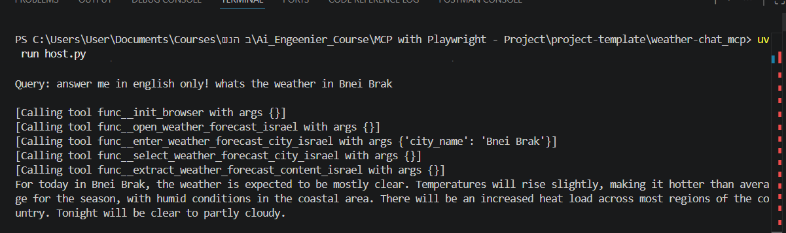

# Weather MCP Israel

MCP Server that provides weather forecasts for cities in Israel by controlling a browser with Playwright and extracting live content from:

https://www.weather2day.co.il/forecast



## Project Purpose

- Build a custom MCP server from scratch.
- Expose browser automation tools to an LLM.
- Let the model answer based on real page content instead of a fixed weather API.

## Tech Stack

- MCP SDK
- Playwright
- Gemini API (OpenAI-compatible endpoint)
- Python + uv

## Repository Structure

- host.py: terminal chat host that connects model + MCP tools.
- client.py: generic MCP stdio client.
- func.py: weather tools implemented with Playwright.
- weather_USA.py: USA weather sample server (reference).
- weather_Israel.py: legacy/alternate Israel file (if present).
- .env: runtime configuration.

## Setup

1. Install dependencies:

```bash
uv sync
```

2. Install Playwright browser runtime:

```bash
uv run playwright install chromium
```

3. Configure environment variables in `.env`:

```dotenv
GEMINI_API_KEY=YOUR_KEY_HERE
# or
GOOGLE_API_KEY=YOUR_KEY_HERE

GEMINI_MODEL=gemini-flash-lite-latest
PLAYWRIGHT_HEADLESS=false
PLAYWRIGHT_BROWSER_CHANNEL=chrome
```

## Run

```bash
uv run host.py
```

After startup, ask questions in the terminal chat.

## Workflow

The weather workflow is based on MCP tools that mirror a real user journey:

1. open_weather_forecast_israel
2. enter_weather_forecast_city_israel(city_name)
3. select_weather_forecast_city_israel
4. extract_weather_forecast_content_israel

This enables the model to answer from the extracted forecast page content.

## Available MCP Tools

- init_browser
- open_weather_forecast_israel
- enter_weather_forecast_city_israel
- select_weather_forecast_city_israel
- extract_weather_forecast_content_israel
- close_browser

## Example Prompts

- מה מזג האוויר היום בתל אביב?
- מה התחזית בירושלים להיום?
- תן סיכום קצר של התחזית בחיפה.

## Troubleshooting

- If the model returns quota/rate errors (429), use another Gemini key/project or wait for quota reset.
- If browser startup fails, verify Playwright installation:

```bash
uv run playwright install chromium
```

- If city selection does not advance, rerun the query with a clear city name.

## Notes

- Data source is website content and may change according to site structure.
- Responses depend on extracted text quality and current page state.
