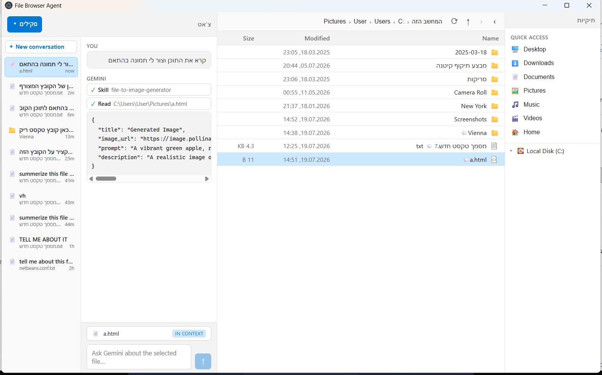

# SKILL-PROJECT (File Browser Agent)

אפליקציית Electron/React לדפדוף קבצים עם צ'אט Agent מובנה. הצ'אט מחובר להקשר של בחירת קובץ/תיקייה ומסוגל להפעיל כלים (Tools), להריץ פקודות באישור משתמש, ולהשתמש ב-Skills מתוך תיקיית Skills.

> מסמך הדרישות המקורי נמצא ב-[SPEC.md](SPEC.md).

## מה בוצע בפרויקט

### 1. מעבר מלא ל-Google Gemini
- הוחלף החיבור מ-Anthropic ל-Gemini דרך `@google/genai`.
- הוחלף chat service ל-[src/main/services/gemini-chat.ts](src/main/services/gemini-chat.ts).
- נשמרה לוגיקת Tool Calling עם הכלים הקיימים ב-[src/main/services/agent-tools.ts](src/main/services/agent-tools.ts).

### 2. ניהול API Key מעודכן
- נוספה תמיכה ידידותית בשגיאות `403` ו-`reported as leaked`.
- נוספה אפשרות `Reset stored key` במסך הזנת מפתח.
- מצב נוכחי: המפתח נשמר רק לסשן ריצה נוכחי, ולכן בכל פתיחה מחדש של האפליקציה תתבקש הזנה מחדש.

קבצים מרכזיים:
- [src/main/secrets.ts](src/main/secrets.ts)
- [src/main/ipc/chat-handlers.ts](src/main/ipc/chat-handlers.ts)
- [src/preload/index.ts](src/preload/index.ts)
- [src/renderer/src/components/chat/ApiKeyPrompt.tsx](src/renderer/src/components/chat/ApiKeyPrompt.tsx)

### 3. תצוגת תמונות ויזואלית בצ'אט
- במקום להציג רק URL, הצ'אט מציג תמונה inline כאשר מתקבל קישור תמונה ישיר.
- יש תמיכה גם בסינטקס Markdown של תמונה.

קבצים מרכזיים:
- [src/renderer/src/components/chat/Markdown.tsx](src/renderer/src/components/chat/Markdown.tsx)
- [src/renderer/src/assets/index.css](src/renderer/src/assets/index.css)

## תמונת דוגמה ותוצר

### תמונה מקומית בתיקיית assets


### URL תוצר לדוגמה
https://image.pollinations.ai/prompt/A%20vibrant%20green%20apple,%20realistic,%20close-up,%20studio%20lighting,%20detailed%20texture,%20fresh%20and%20crisp,%20white%20background

## Skills שצורפו

| Skill | מיקום | מטרה |
|---|---|---|
| summarize-to-readme | [assets/skills/summarize-to-readme/SKILL.md](assets/skills/summarize-to-readme/SKILL.md) | קריאת טקסט ארוך ויצירת README מקצועי ומובנה (כולל טבלאות/דיאגרמות כשצריך) |
| file-to-image-generator | [assets/skills/file-content-to-image-generator/SKILL.md](assets/skills/file-content-to-image-generator/SKILL.md) | ניתוח מסמך, יצירת prompt מפורט, והפקת URL לתמונה דרך Pollinations |

## הרצה מקומית

דרישות:
- Windows
- Node.js 20+

פקודות:

```bash
npm i
node node_modules/electron/install.js
npm run dev
```

פקודות נוספות:

| Command | Description |
|---|---|
| npm run dev | הרצה בפיתוח |
| npm run build | בניית האפליקציה |
| npm start | הרצת build |
| npm run typecheck | בדיקות TypeScript |

## מבנה פרויקט (תמציתי)

```text
src/
   main/      Main process: IPC, services, chat agent, skills
   preload/   contextBridge API ל-renderer
   renderer/  React UI (chat, file browser, tree)
```

## סטאק טכנולוגי

- Electron + electron-vite
- React 19 + TypeScript
- Zustand
- @google/genai
- react-markdown + remark-gfm
- fflate
